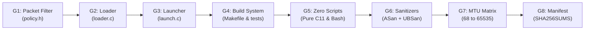

# Security gates and vulnerability ledger

Tracks audit gates, verification evidence, and remediated vulnerabilities for `csumguard` v0.2.0.

---

## Gate pipeline

---

## Gate status summary

| Gate | Scope | Status | Evidence |
|---|---|---|---|
| **G1** | Packet admission & detector predicates | **VERIFIED** | 16,553 checks pass in `tests/test_policy.c` |
| **G2** | Loader lifecycle & path validation | **VERIFIED** | Root-owned path walk, link count 1, fail-closed attach |
| **G3** | Supervisor, vector state & quarantine | **VERIFIED** | 25 suites pass in `tests/test_launch.c`, VULN-LAUNCH-001..007 fixed |
| **G4** | Build system & frame generator | **VERIFIED** | Pure C11 `send_frame`, hardened flags, clean bash testbed |
| **G5** | Zero interpreted scripts | **VERIFIED** | 0 script matches across repository |
| **G6** | Memory & undefined behavior safety | **VERIFIED** | 0 ASan/UBSan findings on sanitized test runs |
| **G7** | MTU boundary matrix | **VERIFIED** | All configurations pass (MTU 68, 1280, 1500, 9000, 65535) |
| **G8** | Manifest integrity | **VERIFIED** | 100% match across all tracked repository files |
| **G9** | Exploit metadata containment (CVE-2026-99999) | **BLOCKED** | TC ingress filter validates payload bytes, not virtio `csum_start`. Fentry detector is non-blocking. Host kernel patch required. |

---

## Remediated vulnerabilities

| ID | Component | Severity | Description | Fix |
|---|---|---|---|---|
| `VULN-KERNEL-001` | `policy.h` | Low | Protocol upper-bit truncation | Mask upper bits before byte swap |
| `VULN-KERNEL-003` | `policy.h` | Low | TCP options tail readability | Explicit tail byte probe via `CSG_READ` |
| `VULN-DETECT-001` | `detect_policy.h` | Medium | 16-bit wrap-around in detector | Reject `network_header == 0xffff` and check bounds |
| `VULN-DETECT-002` | `csumguard_detect.bpf.c` | Low | Kernel read errors folded to 0 | Added explicit probe checks and error counters |
| `VULN-LOADER-001` | `loader.c` | High | Guard stripped on interface transition | Fail-closed cleanup preserves filter if interface is UP |
| `VULN-LOADER-002` | `loader.c` | Medium | Incomplete path check | Path walking from `/` checking root ownership and `st_nlink == 1` |
| `VULN-LOADER-003` | `loader.c` | Low | Counter summation wrap-around | Saturating 64-bit unsigned addition |
| `VULN-LAUNCH-001` | `launch.c` | High | Signals interrupt quarantine | Mask `SIGINT`, `SIGTERM`, `SIGHUP` during teardown |
| `VULN-LAUNCH-002` | `launch.c` | Medium | Normal exit ignored disconnect errors | Force exit code 1 if cleanup disconnect fails |
| `VULN-LAUNCH-003` | `launch.c` | Medium | Orphaned processes on leader exit | Unconditional `kill(-pid, SIGSTOP)` and `SIGKILL` |
| `VULN-LAUNCH-004` | `launch.c` | Medium | Close sentinel dropped on full queue | `pthread_cond_timedwait` drains queue before close |
| `VULN-LAUNCH-005` | `launch_policy.h` | Low | Empty interface names accepted | Strict alphanumeric interface name validation |
| `VULN-LAUNCH-006` | `launch.c` | Medium | Unchained receipts and state collapse | FIPS SHA-256 hash chains and 6D vector state |
| `VULN-LAUNCH-007` | `launch.c` | High | Stack use-after-return in receipt thread | Heap-allocated writer with detached self-cleanup |
| `VULN-BUILD-001` | `Makefile` | Medium | Missing build targets | Added launcher and sender targets |
| `VULN-TESTBED-001` | `testbed.sh` | Medium | Interpreted script dependency | Rewritten in pure Bash with capability checks |
