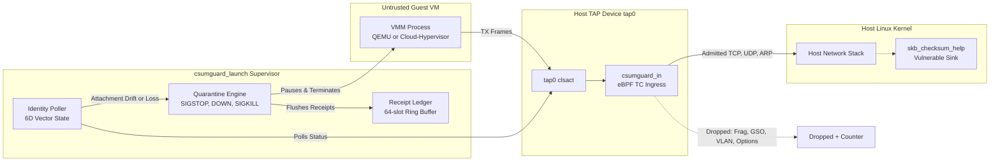
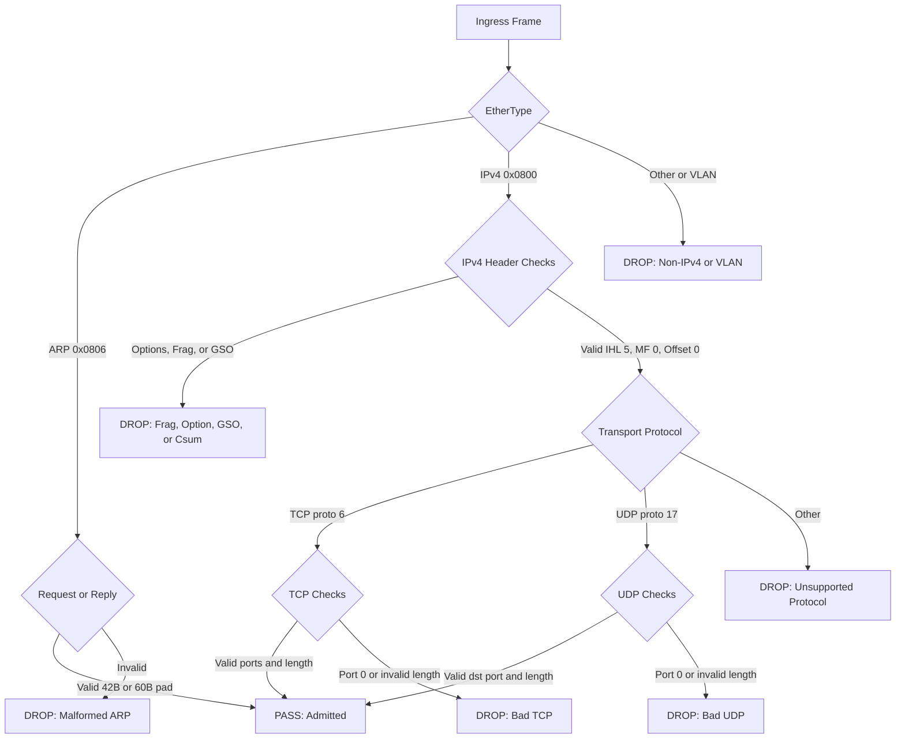
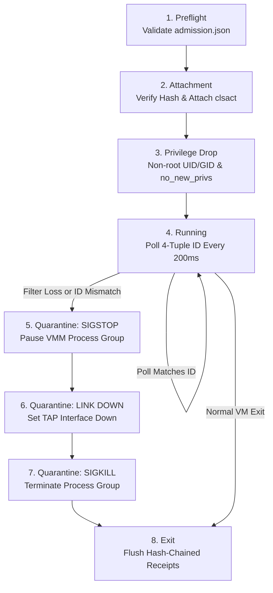

# csumguard

[](https://github.com/MChorfa/csumguard/actions/workflows/ci.yml)
[](VALIDATION.md)
[](Makefile)
[](evidence/sanitizer-execution.log)
[](LICENSE)

An interim packet-admission guard and supervised launcher for [CVE-2026-99999](docs/references.md).

It drops dangerous guest traffic on a VM's TAP interface before the host kernel can reach `skb_checksum_help`. Written in pure C11 and eBPF with zero interpreted scripts.

> **Security Status: GAL 1 · CVE containment unverified · Promotion stopped.**
> All offline policy, detector, launcher, and sanitizer suites pass. However, TC ingress filters validate packet payload bytes, not virtio checksum metadata (`csum_start`). The fentry detector observes suspicious metadata but cannot block execution.
>
> **Authoritative Remediation:** Install the vendor's patched host kernel containing upstream commit [`6785011f8b16`](https://git.kernel.org/linus/6785011f8b16abf40b1e9d8b2e332232b3e68822) and reboot. `csumguard` provides guest traffic hardening and runtime supervision, not verified CVE neutralization. See [VALIDATION.md](VALIDATION.md).

---

## Architecture



---

## Packet admission flow



---

## Supervisor lifecycle and quarantine



---

## Components

| Component | Files | Role |
|---|---|---|
| **Packet filter** | [`policy.h`](policy.h), [`csumguard_tc.bpf.c`](csumguard_tc.bpf.c) | Header-only classifier at TC ingress. Permits standard TCP, UDP, and ARP. Drops fragments, options, GSO, and VLANs. 26 per-CPU counters track reasons. |
| **Checksum detector** | [`detect_policy.h`](detect_policy.h), [`csumguard_detect.bpf.c`](csumguard_detect.bpf.c) | Optional `fentry` probe tracking `CHECKSUM_PARTIAL` packets in the kernel. Increments counters on suspicious offsets. Never blocks. |
| **Loader** | [`loader.c`](loader.c) | Validates file paths from `/` to prevent symlink attacks. Verifies SHA-256 digests, ensures interface is `DOWN`, and attaches `clsact`. |
| **VMM launcher** | [`launch.c`](launch.c), [`launch_policy.h`](launch_policy.h) | Validates operator evidence, drops privileges to non-root UID/GID, starts the VMM, and monitors attachment. Pauses and kills the VM if the filter drops. |
| **Receipt ledger** | [`launch.c`](launch.c) | Asynchronous thread writing FIPS 180-4 SHA-256 hash-chained JSONL records. 64-slot ring buffer prevents disk stalls. |

---

## Quick start

### 1. Build and test offline

```bash
make EGRESS_MTU=1500 all
make test
```

### 2. Attach the filter

Stage the object in a root-owned directory (`/opt/csumguard`), ensure the TAP interface is `DOWN`, and attach:

```bash
/opt/csumguard/csumguard_loader attach tap0 /opt/csumguard/csumguard_tc.bpf.o <EXPECTED_SHA256>
/opt/csumguard/csumguard_loader status tap0 <IFINDEX> <NETNS_INODE> <PROG_ID>
```

### 3. Launch with supervision

Fill out `/etc/csumguard/admission.json` and start the VMM under `csumguard_launch`:

```bash
/opt/csumguard/csumguard_launch \
  --interface tap0 \
  --loader /opt/csumguard/csumguard_loader \
  --object /opt/csumguard/csumguard_tc.bpf.o \
  --evidence /etc/csumguard/admission.json \
  --receipt /var/log/csumguard/tap0.jsonl \
  --uid 65534 \
  --gid 65534 \
  --interval 0.2 \
  -- /usr/bin/qemu-system-x86_64 -netdev tap,id=n0,ifname=tap0,script=no,downscript=no
```

---

## Packaging and OCI distribution

`csumguard` is packaged and distributed as an **OCI v1.1 Artifact** (`application/vnd.csumguard.ebpf.v1`) with attached cryptographic evidence referrers (SLSA v1.0 provenance, CycloneDX v1.6 SBOM, and verification matrix):

```bash
# Package local OCI layout and attach all referrers
./oci/package.sh --layout-dir build/oci-layout --tag v0.2.0

# Discover attached referrers graph
oras discover --oci-layout build/oci-layout:v0.2.0

# Pull directly on hypervisor hosts without container daemon
oras pull ghcr.io/mchorfa/csumguard:v0.2.0
```

See [oci/README.md](oci/README.md) for full OCI media types, descriptors, and Cosign verification workflows.

---

## Verification

```bash
# Verify all source and evidence hashes
shasum -a 256 -c SHA256SUMS

# Run offline test suite
make test

# Run AddressSanitizer and UndefinedBehaviorSanitizer
clang -std=c11 -O1 -g -fsanitize=address,undefined -DEGRESS_MTU=1500 -I. tests/test_policy.c -o /tmp/p_asan && /tmp/p_asan
clang -std=c11 -O1 -g -fsanitize=address,undefined -I. tests/test_launch.c -lpthread -o /tmp/l_asan && /tmp/l_asan
clang -std=c11 -O1 -g -fsanitize=address,undefined tests/send_frame.c -o /tmp/f_asan && /tmp/f_asan --self-test
```

---

## Repository layout

```shell
policy.h                  Packet admission parser and reason codes
detect_policy.h           Checksum partial predicate
launch_policy.h           Admission validator, 6D vector state, and SHA-256
csumguard_tc.bpf.c        TC ingress eBPF program
csumguard_detect.bpf.c    fentry/skb_checksum_help probe
loader.c                  libbpf loader and status reporter
launch.c                  VMM supervisor, quarantine engine, and receipt writer
tests/                    Offline C11 test suites and frame generator
testbed.sh                Lab veth test harness
docs/                     Runbook, admission spec, and CVE references
evidence/                 Verification logs and test records
promotion-gates.yaml      Gate statuses and target requirements
```

---

## Boundaries that matter

1. **Private metadata.** The filter checks L2/L3/L4 packet headers. Small valid TCP/UDP packets can still carry malformed checksum metadata until the host kernel or virtio backend checks them.
2. **Unsupported protocols.** IPv6, ICMP, IP options, and fragmentation are dropped. Guest MTU must match the host route MTU since Path MTU Discovery is disabled.
3. **Supervisor scope.** The launcher is a polling process. A VM process that escapes its session process group needs an external cgroup manager.

---

## Documentation

- [docs/USER_GUIDE.md](docs/USER_GUIDE.md) — Guest network setup, static MTU, offload tuning, and troubleshooting
- [docs/ADMIN_GUIDE.md](docs/ADMIN_GUIDE.md) — OCI packaging, host hardening, admission policy, and incident response
- [docs/RUNBOOK.md](docs/RUNBOOK.md) — Lab deployment, verification, and quarantine runbook
- [docs/ADMISSION.md](docs/ADMISSION.md) — Admission schema, 6D vector state, and cryptographic receipts
- [VALIDATION.md](VALIDATION.md) — Test matrix, MTU boundary results, and verification status
- [GATES.md](GATES.md) — Security audit gates and remediated bug list
- [docs/references.md](docs/references.md) — Upstream Linux kernel commits and CVE notes

---

## License

GPL-2.0. See [LICENSE](LICENSE).
