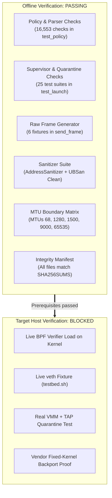

# Validation receipt

Summary of test results, memory safety checks, and remaining target gates.

---

## Verification pipeline

---

## Verification results

| Check | Command | Status | Notes |
|---|---|---|---|
| **Unit tests** | `make test` | **PASS** | 16,553 packet assertions, 25 supervisor suites, 6 frame tests |
| **Sanitizers** | `-fsanitize=address,undefined` | **PASS** | 0 leaks, 0 undefined behavior errors |
| **MTU matrix** | `EGRESS_MTU` $\in \{68, 1280, 9000, 65535\}$ | **PASS** | All boundary configs pass |
| **Shell syntax** | `bash -n testbed.sh` | **PASS** | Clean syntax |
| **Manifest** | `shasum -a 256 -c SHA256SUMS` | **PASS** | 100% hash integrity |
| **Live lab veth** | `sudo bash testbed.sh` | **SKIPPED** | Exits 77 on unprivileged host |
| **Real VMM/TAP** | Target testbed | **BLOCKED** | Requires target Linux hypervisor |

---

## What was verified offline

1. **Parser invariants.** The classifier in [`policy.h`](policy.h) strictly accepts in-profile TCP/UDP and ARP frames. It rejects IPv4 options, fragmentation (`MF=1` or `offset > 0`), GSO, VLAN tags, and checksum corruption.
2. **Supervisor containment.** [`test_launch.c`](tests/test_launch.c) tests 25 scenarios using mock OS operations:
   - Quarantine on filter disappearance or interface change.
   - Signal masking during shutdown.
   - Non-zero exit code if cleanup fails.
   - Non-blocking receipt writes under disk stalls.
3. **Detector safety.** [`detect_policy.h`](detect_policy.h) tests 16-bit wrap-around and boundary conditions for `CHECKSUM_PARTIAL`.
