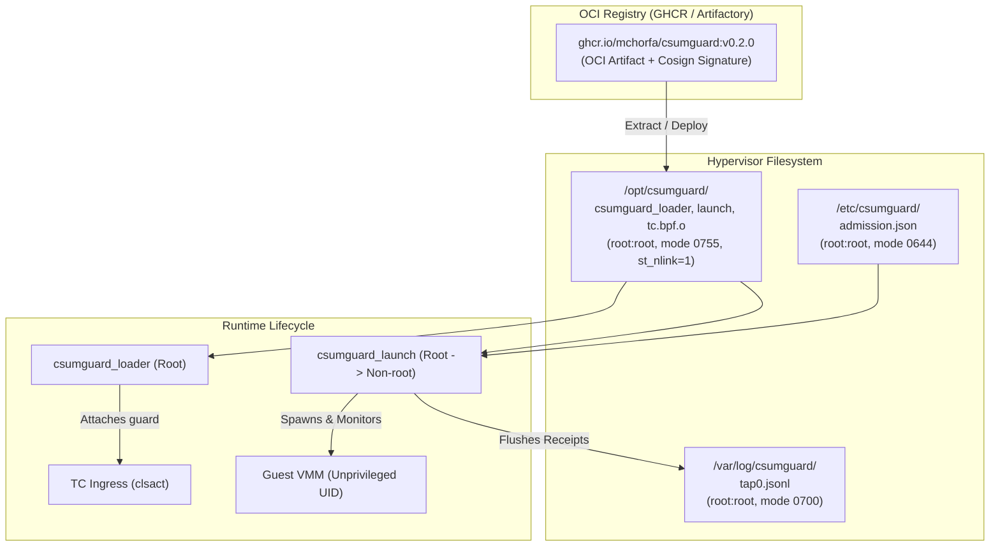

# Administrator guide

This guide covers building, packaging, deploying, and monitoring `csumguard` across hypervisor hosts.

---

## Deployment architecture



---

## 1. Packaging and OCI distribution

### Building the OCI container image
`csumguard` provides a multi-stage `Dockerfile` that builds and tests the C11 and eBPF binaries, checks SHA-256 sums, and copies the verified outputs into a minimal scratch image:

```bash
# Build the OCI artifact
docker build -t ghcr.io/mchorfa/csumguard:v0.2.0 .

# Tag and push to your registry
docker push ghcr.io/mchorfa/csumguard:v0.2.0
```

### Distributing to hypervisors
To deploy the binaries onto hypervisor nodes or Kubernetes nodes (e.g., KubeVirt or Kata Containers), extract the volume from the OCI container:

```bash
docker run --rm \
  -v /opt/csumguard:/target \
  ghcr.io/mchorfa/csumguard:v0.2.0 \
  sh -c "cp /opt/csumguard/* /target/"
```

### Kubernetes DaemonSet installer pattern
For bare-metal Kubernetes clusters running VM workloads, use a privileged init-container to stage the binaries onto `/opt/csumguard` on each node:

```yaml
apiVersion: apps/v1
kind: DaemonSet
metadata:
  name: csumguard-node-installer
  namespace: kube-system
spec:
  selector:
    matchLabels:
      app: csumguard-installer
  template:
    metadata:
      labels:
        app: csumguard-installer
    spec:
      hostPID: true
      initContainers:
        - name: install-binaries
          image: ghcr.io/mchorfa/csumguard:v0.2.0
          command: ["/bin/sh", "-c"]
          args:
            - cp -r /opt/csumguard/* /host/opt/csumguard/ && chmod 755 /host/opt/csumguard/*
          volumeMounts:
            - name: host-opt
              mountPath: /host/opt/csumguard
      containers:
        - name: pause
          image: gcr.io/google-containers/pause:3.2
      volumes:
        - name: host-opt
          hostPath:
            path: /opt/csumguard
            type: DirectoryOrCreate
```

---

## 2. Host filesystem security

`loader.c` and `launch.c` enforce strict filesystem provenance checks to prevent symlink, hardlink, and TOCTOU attacks.

### Mandatory directory permissions
Ensure all deployment directories are owned by `root:root` with no write permissions for group or others:

```bash
sudo mkdir -p /opt/csumguard /etc/csumguard /var/log/csumguard
sudo chown -R root:root /opt/csumguard /etc/csumguard /var/log/csumguard
sudo chmod 755 /opt/csumguard /etc/csumguard
sudo chmod 700 /var/log/csumguard
```

### Verification requirements
- **Path walking:** The loader walks each directory component from `/` using `openat` with `O_NOFOLLOW | O_CLOEXEC`.
- **Link count:** All staged binaries and BPF objects must have link count 1 (`st_nlink == 1`).
- **Immutability:** Do not stage binaries in `/tmp` or shared writable directories.

---

## 3. Admission appraisal policy

Before a VM is launched, `csumguard_launch` reads `/etc/csumguard/admission.json` and asserts:
1. `schema_version` is exactly `"csumguard-admission/v1"`.
2. `running_kernel` matches `uname().release`.
3. `guard_sha256` matches the exact hash of the staged eBPF object.
4. All required boolean assertions are `true`.

### Appraisal template (`/etc/csumguard/admission.json`)

```json
{
  "schema_version": "csumguard-admission/v1",
  "running_kernel": "6.8.0-40-generic",
  "guard_sha256": "893c5d6c54784a0d8e...",
  "kernel_package": "linux-image-6.8.0-40-generic",
  "fix_reference": "CVE-2026-99999",
  "validation_receipt": "receipt-2026-10-16-node01",
  "kernel_patch_verified": false,
  "network_path_validated": true,
  "backend_metadata_validated": true,
  "compatibility_validated": true,
  "exclusive_tc_owner": true
}
```

---

## 4. Monitoring and telemetry

`csumguard` exposes 26 per-CPU reason counters via the `csg_stats` eBPF map.

### Inspecting live status
To query interface attachment and packet drop statistics:

```bash
sudo /opt/csumguard/csumguard_loader status tap0 <IFINDEX> <NETNS_INODE> <PROG_ID>
```

Example JSON output:
```json
{
  "interface": "tap0",
  "ifindex": 12,
  "netns_inode": 4026531992,
  "prog_id": 482,
  "stats": {
    "total_admitted": 142085,
    "drop_bad_ethertype": 4,
    "drop_bad_ipv4_frag": 0,
    "drop_bad_gso": 0,
    "drop_bad_vlan": 0,
    "drop_bad_icmp": 12,
    "drop_bad_tcp_ports": 0,
    "drop_bad_udp_port": 0
  }
}
```

### Telemetry alerting rules
- **High `drop_bad_ipv4_frag`**: Indicates a guest is attempting IPv4 fragmentation or an exploit payload.
- **High `drop_bad_icmp`**: Indicates a guest application is attempting ping or traceroute.
- **Attachment drift**: If `csumguard_loader status` returns a non-zero exit code, the filter has been detached or altered.

---

## 5. Incident response and quarantine

If attachment loss or identity mismatch is detected:
1. `csumguard_launch` masks termination signals.
2. Sends `SIGSTOP` to the VMM process group.
3. Sets `tap0` down.
4. Sends `SIGKILL` to the VMM process group.
5. Flushes a hash-chained JSONL receipt to `/var/log/csumguard/tap0.jsonl`.

### Resetting after a quarantine
To safely clean up and reset the interface:
```bash
# 1. Inspect the receipt log for failure details
tail -n 1 /var/log/csumguard/tap0.jsonl | jq .

# 2. Delete the old TAP interface
sudo ip link delete tap0

# 3. Create a clean TAP interface in DOWN state
sudo ip tuntap add mode tap dev tap0
sudo ip link set dev tap0 down

# 4. Re-attach the filter
DIGEST=$(sha256sum /opt/csumguard/csumguard_tc.bpf.o | cut -d' ' -f1)
sudo /opt/csumguard/csumguard_loader attach tap0 /opt/csumguard/csumguard_tc.bpf.o "$DIGEST"
```
