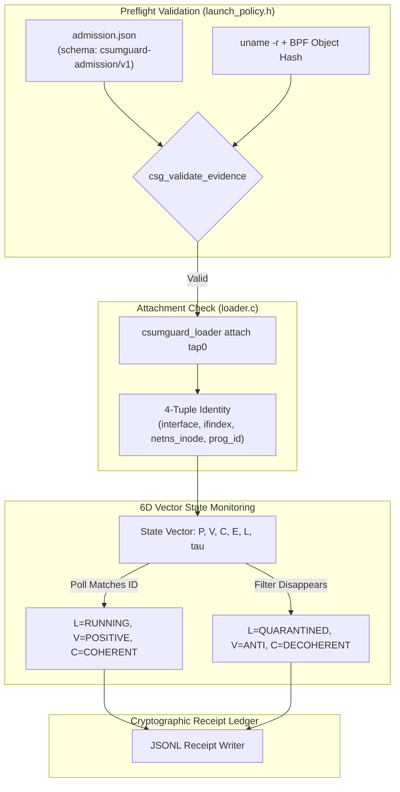
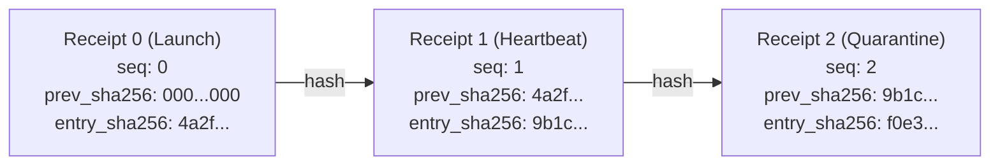

# Admission and receipt contract

Defines preflight admission appraisal, runtime 6D state tracking, and cryptographic receipts.

---

## Admission flow

---

## Hash-chained receipt ledger

Receipts are append-only JSONL records. Each line includes the SHA-256 digest of the previous line:

### Receipt fields

Every record contains:
- `seq` — Zero-indexed monotonic sequence number
- `timestamp_ns` — Monotonic clock time in nanoseconds
- `event` — Event name (`operator_evidence_accepted`, `launched`, `exited`, `denied_or_quarantined`)
- `prev_sha256` — Hex digest of the preceding line
- `entry_sha256` — Hex digest computed over the current record
- `vector_state` — 6D state vector:
  - `presence`: `PRESENT`, `UNKNOWN`
  - `valence`: `POSITIVE`, `NEGATIVE`, `ANTI`, `NEUTRAL`
  - `coherence`: `COHERENT`, `DECOHERENT`
  - `evidence`: `VERIFIED`, `UNVERIFIED`
  - `lifecycle`: `READY`, `STARTED`, `QUARANTINED`, `TERMINATED`, `FAULT`
  - `epoch`: Monotonic state change counter

---

## Security controls

1. **Path walking.** `loader.c` and `launch.c` walk paths from `/` using `openat` with `O_NOFOLLOW | O_CLOEXEC`. Every component must be owned by `root` with permissions `0755` or stricter. Symlinks are rejected.
2. **Hardlink protection.** Staged binaries and BPF objects must have link count 1 (`st_nlink == 1`).
3. **Privilege drop.** The launcher calls `setgroups(0, NULL)`, drops to non-root UID/GID, sets `PR_SET_NO_NEW_PRIVS`, closes extra file descriptors, and scrubs the environment before calling `execve`.
4. **Signal isolation.** During quarantine, termination signals (`SIGINT`, `SIGTERM`, `SIGHUP`) are masked so shutdown cannot be interrupted.

---

## CVE-2026-99999 admission limitation

**Notice:** Operator evidence appraisal requires `kernel_patch_verified: true`. 

The TC ingress filter inspects packet payload bytes, not `virtio-net` checksum descriptor metadata (`csum_start`). Admission of a packet at TC ingress does not guarantee immunity from CVE-2026-99999 if the underlying host kernel is unpatched. 

The mandatory safety invariant `csum_start >= network_header + ip_hdrlen(skb)` must be enforced by a patched host kernel containing commit `6785011f8b16` before `skb_checksum_help()` is reached. `csumguard` acts as defense-in-depth traffic hardening, not an alternative to kernel patching.
