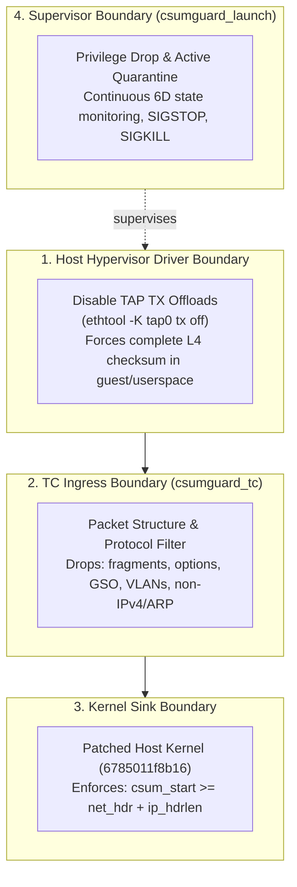

# Architectural Learnings: CVE-2026-99999 and Boundary Enforcement

**Status:** Formal post-mortem and verification engineering analysis  
**Scope:** CVE-2026-99999 mitigation architecture, eBPF TC limitations, and boundary placement  
**Governance:** GAL 1 · CVE Containment Unverified · Promotion Stopped  

---

## 1. Executive summary

During the audit and verification of `csumguard` v0.2.0, we identified a critical architectural limitation:

> **The TC ingress eBPF filter validates packet payload data, but CVE-2026-99999 is triggered by malformed checksum metadata in virtio descriptors (`skb->csum_start`).**

A guest can transmit a frame whose L2, L3, and L4 payload bytes conform 100% to our strict parser rules (e.g. valid IPv4 TCP SYN without options or fragments), but whose virtio descriptor sets `csum_start` to an invalid offset inside the IPv4 header. 

When the host network stack later calls `skb_checksum_help()`, the kernel uses the malicious offset, corrupting host memory.

Because TC ingress eBPF filters do not inspect or modify `skb->csum_start`, and because `fentry` probes cannot drop packets or block execution, **`csumguard` cannot guarantee exploit containment on an unpatched host kernel**.

In accordance with Verification Engineering principles, promotion has been halted and the claim of CVE mitigation has been withdrawn pending proven metadata boundary enforcement.

---

## 2. Anatomy of the vulnerability

### The virtio-net checksum offload path
In virtualized environments (QEMU, Cloud-Hypervisor, KubeVirt, Firecracker), network transmission proceeds as follows:

```text
Untrusted Guest Kernel
      │  Transmits packet with TX checksum offload enabled
      ▼
Virtio-Net Emulation (virtio_net_hdr)
      │  flags: VIRTIO_NET_HDR_F_NEEDS_CSUM
      │  csum_start: byte offset from start of packet to L4 header
      │  csum_offset: offset from csum_start to checksum field
      ▼
Host TAP Driver (/dev/net/tun)
      │  Allocates host sk_buff
      │  skb->ip_summed = CHECKSUM_PARTIAL
      │  skb->csum_start = csum_start
      │  skb->csum_offset = csum_offset
      ▼
Host Network Stack Ingress (TC clsact)
      │  [csumguard_in eBPF Filter]
      │  Inspects skb->data (packet payload bytes)
      ▼
Kernel Forwarding / Netfilter / Bridge
      │  Kernel prepares packet for transmission or re-routing
      ▼
skb_checksum_help(skb)  <--- VULNERABLE SINK
      │  Computes checksum from skb->csum_start
      │  Writes checksum at skb->csum_start + skb->csum_offset
```

### The exploit mechanism
If an attacker inside the guest controls the virtio descriptor, they can specify:
```text
csum_start < skb->network_header + ip_hdrlen(skb)
```
For example, pointing `csum_start` directly into the IPv4 header (`ip[10..11]` or `ip[0..3]`). 

When `skb_checksum_help()` is invoked:
1. It computes the 16-bit one's complement sum starting from `csum_start`.
2. It writes the resulting 2-byte checksum into `csum_start + csum_offset`.
3. Because `csum_start` points into the IPv4 header or earlier buffer space, the write corrupts critical kernel headers, packet metadata, or surrounding kernel memory.

---

## 3. The upstream kernel fix

Upstream Linux kernel maintainers addressed this vulnerability in commit [`6785011f8b16`](https://git.kernel.org/linus/6785011f8b16abf40b1e9d8b2e332232b3e68822) titled `ipv4: validate checksum_start before completing checksum`.

The patch adds an explicit pre-condition check before `skb_checksum_help()`:

```c
static inline int ip_check_csum_start(const struct sk_buff *skb)
{
    if (unlikely(skb->csum_start <
                 skb->network_header + ip_hdrlen(skb)))
        return -EINVAL;

    return 0;
}
```

The mandatory safety invariant is:
$$\text{csum\_start} \ge \text{network\_header} + \text{ip\_hdrlen}(\text{skb})$$

### Fixed stable branches
| Branch | Fixed Release |
| :--- | :--- |
| **Linux 5.10** | `5.10.272` |
| **Linux 5.15** | `5.15.223` |
| **Linux 6.1** | `6.1.190` |
| **Linux 6.6** | `6.6.159` |
| **Linux 6.12** | `6.12.113` |
| **Linux 6.18** | `6.18.57` |

**Authoritative remediation:** Hypervisor hosts must be updated to a patched kernel and rebooted.

---

## 4. Why TC ingress eBPF was insufficient

Our original architectural hypothesis assumed that dropping malformed packets at TC ingress would prevent the exploit. That hypothesis failed for three technical reasons:

### Reason 1: TC ingress inspects bytes, not descriptor metadata
The TC BPF context `struct __sk_buff` provides direct access to packet data via `data` and `data_end` (or `bpf_skb_load_bytes`). However, `struct __sk_buff` does not expose `skb->csum_start` or `skb->csum_offset`. 

A packet can have pristine IP and TCP headers on the wire while its underlying `sk_buff` holds poisoned `csum_start` metadata.

### Reason 2: Fentry probes are observational only
`csumguard_detect.bpf.c` attached to `fentry/skb_checksum_help` and used BPF CO-RE to inspect `skb->csum_start`. When `csg_suspicious()` triggered, it incremented a counter.

However, `fentry` probes run in tracing context. They cannot alter the control flow of the probed function, cannot drop the `sk_buff`, and cannot return `-EINVAL` on behalf of the kernel. Observing the attack in `fentry` occurs at the exact moment the vulnerable code executes.

### Reason 3: vhost-net bypasses userspace
In production virtualization using `vhost-net`, virtio descriptor processing is handled entirely inside the host kernel (`drivers/vhost/net.c`). Userspace VMM wrappers never see the individual packet buffers, meaning userspace filters cannot intercept the descriptor metadata.

---

## 5. The verification engineering lesson

The project passed 16,553 unit test assertions, clean AddressSanitizer and UndefinedBehaviorSanitizer runs, and strict zero-interpreted-script checks.

Yet none of those tests proved exploit containment.

### The green CI fallacy
* **What our tests proved:** The C11 parser in `policy.h` correctly parses Ethernet, IPv4, TCP, UDP, and ARP frames, rejecting options, fragments, and size violations. The supervisor in `launch.c` correctly drops privileges and executes quarantine.
* **What our tests assumed:** That any packet capable of triggering `skb_checksum_help` memory corruption must violate packet payload syntax.
* **The reality:** The exploit lives in virtio metadata outside the parser's field of view.

Testing an enforcement point that is blind to the vulnerability's root cause produces a false sense of security. True Verification Engineering requires validating that the enforcement boundary has direct, causal visibility into the exploit condition.

---

## 6. Evolved defense-in-depth architecture

To make `csumguard` an effective security control, enforcement must be separated into distinct boundaries:



### Interim host mitigation: disabling TAP offloads
Before a patched host kernel can be rebooted, hypervisor operators can disable TX checksum offloading on the guest's TAP device:

```bash
ethtool -K tap0 tx off
```

When TX checksumming is disabled on the TAP interface:
1. The TAP driver does not advertise `TUN_F_CSUM` to the guest.
2. The guest is forced to compute complete L4 checksums in userspace or guest kernel before transmitting.
3. Packets entering the host stack carry `ip_summed = CHECKSUM_NONE` (or `CHECKSUM_UNNECESSARY`), completely bypassing the vulnerable `skb_checksum_help()` sink.

---

## 7. Action items and acceptance criteria

1. **Host Kernel Remediation (P0):** Update all hypervisor hosts to kernel versions containing commit `6785011f8b16`.
2. **TAP Offload Preflight (P0):** Add ethtool TX offload validation to `loader.c` and `launch.c`. Reject admission if TAP TX checksum offload is active on an unpatched kernel.
3. **Repository Transparency (Completed):** Mark promotion gate `G9` as blocked, withdraw CVE neutralization claims, and update `VALIDATION.md` and `README.md`.
4. **Acceptance Criterion for Future Promotion:**
   > *No guest-controlled checksum metadata may reach a vulnerable host checksum-completion operation unless its safety invariants have been independently enforced.*
