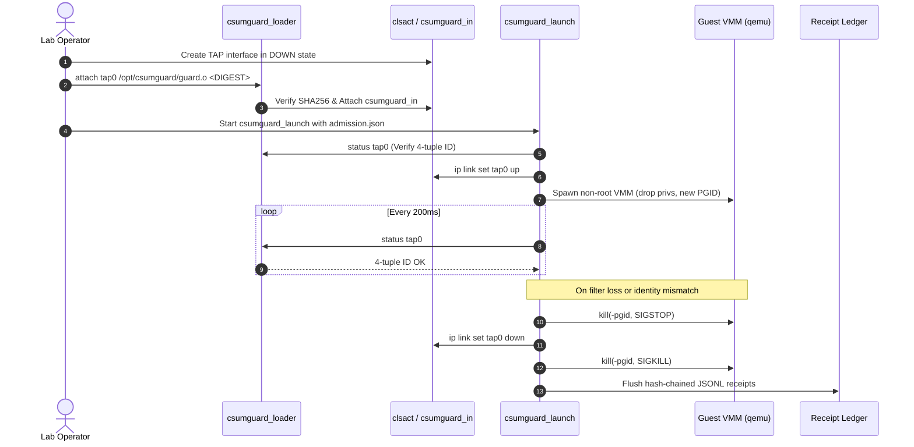

# Operational runbook

An interim procedure for testing and operating `csumguard` in an isolated lab.

---

## Deployment and quarantine sequence



---

## Step-by-step setup

### 1. Host inventory
Record your running kernel release, VMM version, and networking setup:
```bash
uname -r
ip link show
```

### 2. Build on the target host
```bash
make EGRESS_MTU=1500 all
make test
```

### 3. Stage immutable binaries
Move built binaries to a root-owned, non-writable directory:
```bash
sudo mkdir -p /opt/csumguard /etc/csumguard /var/log/csumguard
sudo cp build/csumguard_loader build/csumguard_launch build/csumguard_tc.bpf.o /opt/csumguard/
sudo chmod 755 /opt/csumguard/*
sudo chown root:root /opt/csumguard/*
```

### 4. Create the TAP interface in DOWN state
```bash
sudo ip tuntap add mode tap dev tap0
sudo ip link set dev tap0 down
```

### 5. Attach the TC filter
Calculate the BPF object digest and attach it:
```bash
DIGEST=$(sha256sum /opt/csumguard/csumguard_tc.bpf.o | cut -d' ' -f1)
sudo /opt/csumguard/csumguard_loader attach tap0 /opt/csumguard/csumguard_tc.bpf.o "$DIGEST"
```

### 6. Fill out the admission appraisal
Create `/etc/csumguard/admission.json` with your verified kernel release and object hash:

```json
{
  "schema_version": "csumguard-admission/v1",
  "running_kernel": "REPLACE_WITH_UNAME_R",
  "guard_sha256": "REPLACE_WITH_SHA256_OF_BPF_OBJECT",
  "kernel_package": "linux-image-6.8.0-generic",
  "fix_reference": "CVE-2026-99999",
  "validation_receipt": "receipt-2026-10-16-lab",
  "kernel_patch_verified": false,
  "network_path_validated": true,
  "backend_metadata_validated": true,
  "compatibility_validated": true,
  "exclusive_tc_owner": true
}
```

### 7. Start the VMM under supervision
```bash
sudo /opt/csumguard/csumguard_launch \
  --interface tap0 \
  --loader /opt/csumguard/csumguard_loader \
  --object /opt/csumguard/csumguard_tc.bpf.o \
  --evidence /etc/csumguard/admission.json \
  --receipt /var/log/csumguard/tap0.jsonl \
  --uid 65534 \
  --gid 65534 \
  --interval 0.2 \
  -- /usr/bin/qemu-system-x86_64 -netdev tap,id=net0,ifname=tap0,script=no,downscript=no
```

---

## Quarantine response

If the TC filter is removed, replaced, or its network namespace changes:
1. `csumguard_launch` masks termination signals.
2. It sends `SIGSTOP` to the VMM process group.
3. It sets `tap0` down.
4. It sends `SIGKILL` to the VMM process group.
5. It flushes receipts to `/var/log/csumguard/tap0.jsonl`.
6. It exits with code 1.

Check the receipt file for failure details:
```bash
tail -n 5 /var/log/csumguard/tap0.jsonl
```
