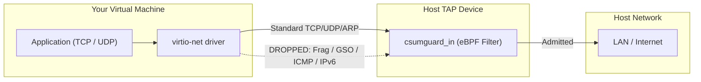

# User guide

This guide explains how to run virtual machine workloads under `csumguard` traffic filtering and supervision.

---

## What csumguard does to your VM network

`csumguard` attaches an eBPF filter to your VM's TAP interface on the host. It blocks the attack vectors of [CVE-2026-99999](references.md) by dropping unexpected or malformed traffic before the host kernel processes it.



### Traffic rules

| Traffic type | Status | Reason / Action |
|---|---|---|
| **IPv4 TCP** | **ALLOWED** | Standard TCP connections (source and destination ports must be $> 0$). |
| **IPv4 UDP** | **ALLOWED** | Standard UDP traffic (destination port must be $> 0$). |
| **ARP** | **ALLOWED** | Standard 42-byte ARP requests and replies (padded to 60 bytes if needed). |
| **IPv6** | **DROPPED** | All IPv6 packets are denied. Use IPv4 inside the guest. |
| **ICMP (ping, traceroute)** | **DROPPED** | Denied at ingress. Ping will not work. |
| **IPv4 Fragmentation** | **DROPPED** | Packets with `MF=1` or fragment offset $> 0$ are dropped. Set MTU properly. |
| **GSO / TSO Offload** | **DROPPED** | Large offloaded frames are dropped. Disable offloads or match MTU. |
| **VLAN tags** | **DROPPED** | 802.1Q tagged frames are dropped. |

---

## Guest OS configuration

Because `csumguard` drops ICMP, Path MTU Discovery (PMTUD) will not work. You must configure the guest interface with matching MTU and disable offloads that generate jumbo frames.

### 1. Set static MTU
Configure the network interface inside your guest to match the host `EGRESS_MTU` (default `1500`):

```bash
# In Linux guest:
sudo ip link set dev eth0 mtu 1500
```

### 2. Disable guest TX offloads
If your guest generates segmentation offload packets (GSO/TSO), `csumguard` will drop them at the TAP boundary. Turn off offload inside the guest:

```bash
sudo ethtool -K eth0 tso off gso off gro off
```

To make this permanent in Ubuntu/Debian guest, add to `/etc/network/interfaces` or systemd-networkd:
```ini
[Link]
MTUBytes=1500

[Network]
# Ensure offloads are managed if supported
```

---

## Running a VM under csumguard_launch

The launcher drops host privileges to a non-root account, starts the VMM, and monitors the TAP filter.

### QEMU example

```bash
csumguard_launch \
  --interface tap0 \
  --loader /opt/csumguard/csumguard_loader \
  --object /opt/csumguard/csumguard_tc.bpf.o \
  --evidence /etc/csumguard/admission.json \
  --receipt /var/log/csumguard/tap0.jsonl \
  --uid 65534 \
  --gid 65534 \
  --interval 0.2 \
  -- /usr/bin/qemu-system-x86_64 \
     -m 2048 \
     -smp 2 \
     -drive file=/var/lib/images/guest.qcow2,if=virtio \
     -netdev tap,id=net0,ifname=tap0,script=no,downscript=no \
     -device virtio-net-pci,netdev=net0,mac=52:54:00:12:34:56
```

### Cloud-Hypervisor example

```bash
csumguard_launch \
  --interface tap0 \
  --loader /opt/csumguard/csumguard_loader \
  --object /opt/csumguard/csumguard_tc.bpf.o \
  --evidence /etc/csumguard/admission.json \
  --receipt /var/log/csumguard/tap0.jsonl \
  --uid 65534 \
  --gid 65534 \
  --interval 0.2 \
  -- /usr/bin/cloud-hypervisor \
     --memory size=2G \
     --cpus boot=2 \
     --disk path=/var/lib/images/guest.raw \
     --net tap=tap0,mac=52:54:00:12:34:56
```

---

## Troubleshooting

### Ping / traceroute fails
**Expected behavior.** ICMP is intentionally blocked to protect against exploit sequences. Use application-level probes (such as `curl` or `nc -zvw3 <ip> <port>`) to verify network connectivity.

### Connections hang or drop on large transfers
**Cause:** The guest is attempting to send packets larger than `1500` bytes or using segmentation offload.
**Fix:**
```bash
sudo ip link set dev eth0 mtu 1500
sudo ethtool -K eth0 tso off gso off gro off
```

### VM suddenly terminated
If the eBPF filter on the host is detached, modified, or the interface namespace changes, `csumguard_launch` immediately halts the VM to prevent unshielded traffic.

Check the receipt log on the host to see the termination reason:
```bash
tail -n 1 /var/log/csumguard/tap0.jsonl | jq .
```
Look for `event: "denied_or_quarantined"`.
