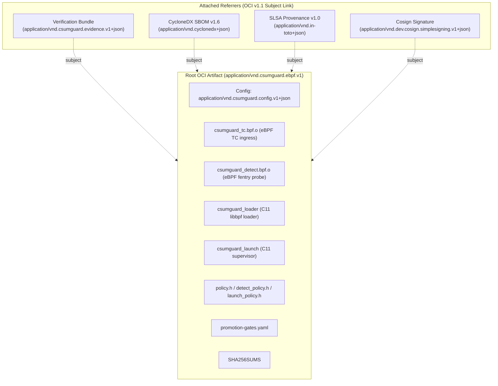

# OCI Artifact & Attachments Specification

`csumguard` distributes its eBPF bytecode, native C11 loader, supervisor, and governance receipts as an **OCI v1.1 Artifact** with attached referrers (SLSA provenance, CycloneDX SBOM, and verification evidence).

---

## 1. Referrers Graph Architecture



---

## 2. MIME Types & Descriptors

| Descriptor | Media Type | Purpose |
| :--- | :--- | :--- |
| **Root Manifest** | `application/vnd.oci.image.manifest.v1+json` | Top-level OCI v1.1 artifact manifest |
| **Artifact Type** | `application/vnd.csumguard.ebpf.v1` | Declares the semantic kind of the artifact |
| **Config** | `application/vnd.csumguard.config.v1+json` | Machine-verifiable metadata (target kernel, MTU, compiler) |
| **eBPF Layer** | `application/vnd.csumguard.ebpf.layer.v1+binary` | Compiled `bpfel` bytecode object |
| **Loader Layer** | `application/vnd.csumguard.loader.v1+elf` | Native C11 libbpf attachment binary |
| **Supervisor Layer** | `application/vnd.csumguard.supervisor.v1+elf` | Native C11 VMM confinement supervisor |
| **Policy Headers** | `text/x-c` | Pure semantic kernel and gate headers |
| **Evidence Attachment** | `application/vnd.csumguard.evidence.v1+json` | Verification matrix and test execution logs |
| **SBOM Attachment** | `application/vnd.cyclonedx+json` | CycloneDX v1.6 Bill of Materials |
| **Provenance Attachment** | `application/vnd.in-toto+json` | SLSA v1.0 build provenance attestation |

---

## 3. Packaging & Verification CLI Workflows

### Building the OCI Layout Locally
```bash
./oci/package.sh --layout-dir build/oci-layout --tag v0.2.0
```

### Inspecting the Referrers Tree
```bash
oras discover --oci-layout build/oci-layout:v0.2.0
```

### Pushing to a Remote Registry
```bash
./oci/package.sh --push ghcr.io/mchorfa/csumguard:v0.2.0
```

### Pulling the Artifact & Attachments
```bash
# Pull the core artifact
oras pull ghcr.io/mchorfa/csumguard:v0.2.0

# Discover attachments
oras discover ghcr.io/mchorfa/csumguard:v0.2.0

# Pull verification evidence
oras pull ghcr.io/mchorfa/csumguard:v0.2.0 --include-subject
```

### Cryptographic Verification with Cosign
```bash
# Verify signature
cosign verify --key cosign.pub ghcr.io/mchorfa/csumguard:v0.2.0

# Verify SLSA attestation
cosign verify-attestation --key cosign.pub --type slsaprovenance ghcr.io/mchorfa/csumguard:v0.2.0
```
