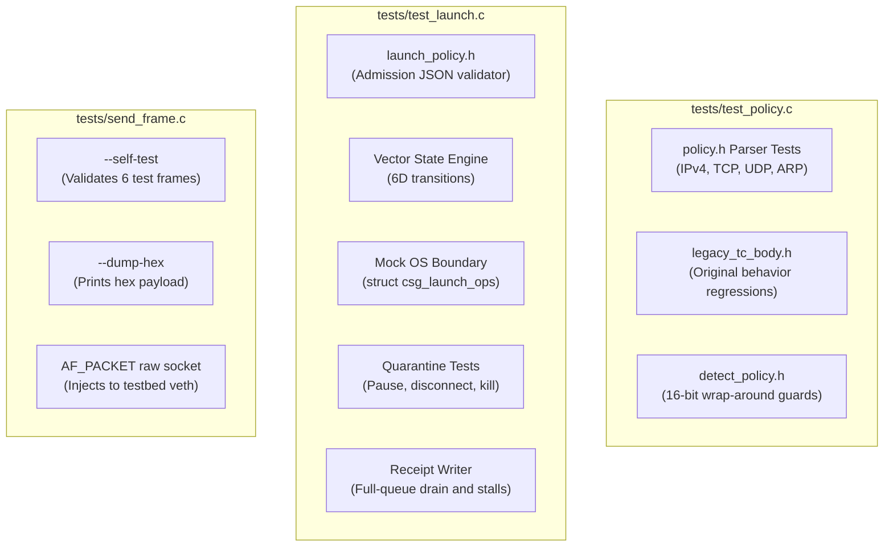

# Test suites

Describes the offline C11 test binaries and fixtures.

---

## Test architecture



---

## Running the tests

```bash
# Run all unit tests
make test

# Run individual test binaries
./build/test_policy
./build/test_launch
./build/send_frame --self-test
```

### Coverage summary

- `test_policy.c` — Exercises `policy.h` and `detect_policy.h` without BPF dependencies. Tests fragmentation flags, TCP options, ARP padding, checksum corruption, and upper-bit protocol truncation.
- `test_launch.c` — Tests `launch_policy.h` and `launch.c` using an injected operations table (`struct csg_launch_ops`). Verifies signal isolation, receipt ring buffer behavior, privilege dropping, and quarantine teardown.
- `send_frame.c` — Generates raw Ethernet frames for lab testing. Includes an offline `--self-test` mode to verify packet structures on any POSIX system.
